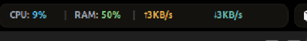
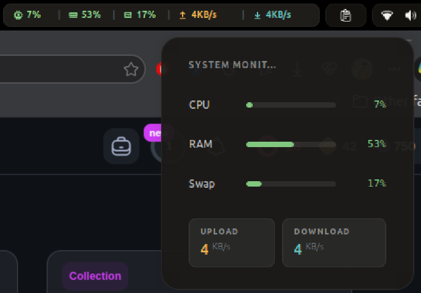

# System Monitor

A lightweight, professional GNOME Shell extension that displays real-time system resource usage directly in your top panel.


## Features

- **CPU Usage** - Real-time CPU utilization percentage
- **GPU Monitoring** - Auto-detects NVIDIA (via nvidia-smi) and AMD GPUs
- **RAM Usage** - Memory consumption with percentage and detailed popup
- **Swap Usage** - Swap space utilization
- **Network Speed** - Live upload/download speeds in KB/s or MB/s
- **Monochrome Mode** - Optional neutral indicators for users who prefer native-looking panel styling


## Architecture Diagram

```mermaid
flowchart TD

subgraph group_platform["Platform Sources"]
  node_proc_stat[("CPU Statistics")]
  node_proc_meminfo[("Memory Statistics")]
  node_proc_netdev[("Network Statistics")]
  node_gpu_sysfs[("GPU Sysfs")]
  node_hwmon[("Temperature Sensors")]
end

subgraph group_runtime["Monitoring Runtime"]
  node_modern_runtime["Modern Runtime<br/>[extension.js]"]
  node_legacy_runtime["Legacy Runtime<br/>[extensionLegacy.js]"]
  node_cpu_sampler["CPU Sampler<br/>[extension.js]"]
  node_memory_sampler["Memory Sampler<br/>[extension.js]"]
  node_network_sampler["Network Sampler<br/>[extension.js]"]
  node_gpu_sampler["GPU Sampler<br/>[extension.js]"]
  node_temp_sampler["Temperature Sampler<br/>[extension.js]"]
end

subgraph group_presentation["Shell Presentation"]
  node_panel["Panel Indicators<br/>[extension.js]"]
  node_popup["Detail Popup<br/>[extension.js]"]
  node_charts["History Charts<br/>[extension.js]"]
end

subgraph group_configuration["Configuration"]
  node_settings[("Extension Settings")]
  node_preferences["Preferences UI<br/>[prefs.js]"]
end

node_user(("User"))
node_gnome_shell(("GNOME Shell"))
node_nvidia_cli["NVIDIA CLI"]

node_user -->|"enables extension"| node_gnome_shell
node_gnome_shell -->|"loads variant"| node_modern_runtime
node_gnome_shell -.->|"loads variant"| node_legacy_runtime

node_modern_runtime -->|"adds status area"| node_gnome_shell
node_legacy_runtime -.->|"adds status area"| node_gnome_shell

node_modern_runtime -->|"samples CPU"| node_cpu_sampler
node_modern_runtime -->|"samples memory"| node_memory_sampler
node_modern_runtime -->|"samples network"| node_network_sampler
node_modern_runtime -->|"samples GPU"| node_gpu_sampler
node_modern_runtime -->|"samples temperature"| node_temp_sampler

node_legacy_runtime -.->|"samples CPU"| node_cpu_sampler
node_legacy_runtime -.->|"samples memory"| node_memory_sampler
node_legacy_runtime -.->|"samples network"| node_network_sampler
node_legacy_runtime -.->|"samples GPU"| node_gpu_sampler
node_legacy_runtime -.->|"samples temperature"| node_temp_sampler

node_cpu_sampler -->|"reads statistics"| node_proc_stat
node_memory_sampler -->|"reads statistics"| node_proc_meminfo
node_network_sampler -->|"reads statistics"| node_proc_netdev
node_gpu_sampler -->|"reads AMD state"| node_gpu_sysfs
node_gpu_sampler -.->|"runs nvidia-smi"| node_nvidia_cli
node_temp_sampler -->|"reads sensors"| node_hwmon

node_modern_runtime -->|"updates indicators"| node_panel
node_legacy_runtime -.->|"updates indicators"| node_panel

node_modern_runtime -->|"updates details"| node_popup
node_legacy_runtime -.->|"updates details"| node_popup

node_modern_runtime -->|"updates history"| node_charts
node_legacy_runtime -.->|"updates history"| node_charts

node_user -->|"opens details"| node_panel
node_panel -->|"opens popup"| node_popup

node_preferences -->|"writes preferences"| node_settings
node_modern_runtime -->|"reads settings"| node_settings
node_legacy_runtime -.->|"reads settings"| node_settings

node_settings -->|"controls visibility"| node_panel
node_settings -->|"controls visibility"| node_popup

click node_modern_runtime "https://github.com/talhasiddique7/sys-monitor/blob/main/extension.js"
click node_legacy_runtime "https://github.com/talhasiddique7/sys-monitor/blob/main/extensionLegacy.js"
click node_cpu_sampler "https://github.com/talhasiddique7/sys-monitor/blob/main/extension.js"
click node_memory_sampler "https://github.com/talhasiddique7/sys-monitor/blob/main/extension.js"
click node_network_sampler "https://github.com/talhasiddique7/sys-monitor/blob/main/extension.js"
click node_gpu_sampler "https://github.com/talhasiddique7/sys-monitor/blob/main/extension.js"
click node_temp_sampler "https://github.com/talhasiddique7/sys-monitor/blob/main/extension.js"
click node_settings "https://github.com/talhasiddique7/sys-monitor/blob/main/schemas/org.gnome.shell.extensions.sysmon.gschema.xml"
click node_preferences "https://github.com/talhasiddique7/sys-monitor/blob/main/prefs.js"
click node_panel "https://github.com/talhasiddique7/sys-monitor/blob/main/extension.js"
click node_popup "https://github.com/talhasiddique7/sys-monitor/blob/main/extension.js"
click node_charts "https://github.com/talhasiddique7/sys-monitor/blob/main/extension.js"

classDef toneNeutral fill:#f8fafc,stroke:#334155,stroke-width:1.5px,color:#0f172a
classDef toneBlue fill:#dbeafe,stroke:#2563eb,stroke-width:1.5px,color:#172554
classDef toneAmber fill:#fef3c7,stroke:#d97706,stroke-width:1.5px,color:#78350f
classDef toneMint fill:#dcfce7,stroke:#16a34a,stroke-width:1.5px,color:#14532d
classDef toneRose fill:#ffe4e6,stroke:#e11d48,stroke-width:1.5px,color:#881337
classDef toneIndigo fill:#e0e7ff,stroke:#4f46e5,stroke-width:1.5px,color:#312e81
classDef toneTeal fill:#ccfbf1,stroke:#0f766e,stroke-width:1.5px,color:#134e4a

class node_proc_stat,node_proc_meminfo,node_proc_netdev,node_gpu_sysfs,node_hwmon,node_user toneBlue
class node_modern_runtime,node_legacy_runtime,node_cpu_sampler,node_memory_sampler,node_network_sampler,node_gpu_sampler,node_temp_sampler toneAmber
class node_panel,node_popup,node_charts toneMint
class node_settings,node_preferences toneRose
class node_gnome_shell,node_nvidia_cli toneIndigo
```



### Visual Indicators

| Color | Threshold | Meaning |
|-------|-----------|---------|
| 🟢 Green | < 60% | Normal usage |
| 🟡 Orange | 60-79% | Warning level |
| 🔴 Red | 80%+ | Critical usage |

### Panel Display

The extension adds compact, icon-based metrics to your GNOME panel:
- CPU, RAM, Swap percentages with dynamic color coding
- Upload and download speeds
- Click for detailed popup with progress bars

## Installation

### Install from GNOME Extensions (Recommended)

The easiest way to install is directly from the GNOME Extensions website:

**[Download from extensions.gnome.org](https://extensions.gnome.org/extension/9838/system-monitor/)**

After installing, enable the extension via the Extensions app or run:
```bash
gnome-extensions enable sysmonitor@talhasiddique7
```

### Quick Install (Manual)

```bash
git clone https://github.com/talhasiddique7/sys-monitor.git
cd sys-monitor
chmod +x install.sh
./install.sh
```

Then restart GNOME Shell:
- **X11**: Press `Alt+F2`, type `r`, press Enter
- **Wayland**: Log out and log back in

Enable the extension:
```bash
gnome-extensions enable sysmonitor@talhasiddique7
```

### Manual Install

1. Copy the extension folder to `~/.local/share/gnome-shell/extensions/sysmonitor@talhasiddique7/`
2. Compile schemas: `glib-compile-schemas schemas/`
3. Restart GNOME Shell and enable via Extensions app

## Configuration

Open **Extensions → System Monitor → Settings** to customize:

| Setting | Description | Default |
|---------|-------------|---------|
| Refresh interval | Update frequency (1-10 seconds) | 2s |
| Monochrome mode | Use one neutral color instead of status colors | Disabled |
| Show CPU | Display CPU usage in panel & popup | Enabled |
| Show RAM | Display RAM usage in panel & popup | Enabled |
| Show GPU | Display GPU in popup | Enabled |
| Show Swap | Display swap in panel & popup | Enabled |
| Show Network | Display network speeds | Enabled |

## Requirements

- **GNOME Shell**:
  - Modern package (`extension.js`/`prefs.js`): 45, 46, 47, 48, 49, 50
  - Legacy package (`extensionLegacy.js`/`prefsLegacy.js`): 40, 41, 42, 43, 44
- **GPU Support** (optional):
  - NVIDIA: `nvidia-smi` must be in PATH
  - AMD: `sysfs` interface at `/sys/class/drm/card0/device/gpu_busy_percent`

## Validation

Run syntax, schema, metadata, packaging, and archive-integrity checks with:

```bash
make check
```

Build both GNOME upload artifacts without installing either:

```bash
make pack-dual
```

Running `make` or `make install` detects the GNOME Shell major version and installs the matching variant. When a unit-test runner is configured, `make check` runs it automatically.

## Technical Details

The extension reads system data from:
- `/proc/stat` - CPU statistics
- `/proc/meminfo` - Memory and swap info
- `/proc/net/dev` - Network interface statistics

All monitoring is done locally without external dependencies (except for NVIDIA GPU support).

## Screenshots

### Panel View
Compact indicators in the GNOME top panel showing real-time system metrics:



### Detailed Popup
Click any panel indicator to open the detailed popup with progress bars:



## Contributing

Contributions are welcome! Please feel free to submit issues or pull requests.

## License

MIT License - see LICENSE file for details.

---

**Author**: [@talhasiddique7](https://github.com/talhasiddique7)
